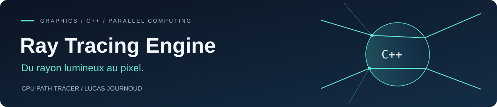
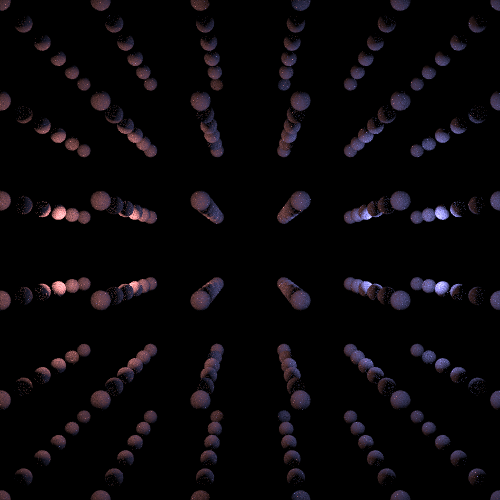

<p align="center">
  
</p>

<p align="center">
  
  
  
  
</p>

## De la géométrie à la lumière

Un **path tracer sur CPU développé en C++**, commencé dans un cadre académique puis poursuivi personnellement. L’objectif : comprendre et implémenter les étapes du rendu, des intersections rayon–sphère au transport de la lumière, puis travailler sur le coût des calculs et la parallélisation.

Le projet utilise la **bibliothèque standard C++**, sans moteur de rendu externe. Il reste un laboratoire d’expérimentation, et non un moteur de production ou un renderer temps réel.

<p align="center">
  
  <br />
  <sub>Rendu calculé avec le moteur : scène alternative, miroir et verre. Aucun visuel généré par IA.</sub>
</p>

[Fonctionnalités](#fonctionnalités) · [Architecture](#architecture) · [Compilation](#compiler-et-exécuter) · [Paramètres](#paramètres-de-rendu) · [Limites](#état-actuel-et-pistes-dévolution)

## Fonctionnalités

### Lumière & matériaux

- **Intersections rayon–sphère** et recherche de l’intersection la plus proche.
- Matériaux **diffus**, **miroirs** et **verre**.
- Réflexion spéculaire, réfraction selon l’indice du matériau et approximation de Schlick pour le partage réflexion/transmission.
- Éclairage direct avec rayons d’ombre, rebonds indirects et surfaces émissives.
- Échantillonnage de directions sur l’hémisphère pondéré par le cosinus.
- **Roulette russe** pour interrompre probabilistiquement les chemins, avec compensation du poids et profondeur maximale.

### Calcul & image

- Accumulation de plusieurs échantillons par pixel avec décalage aléatoire du rayon primaire.
- Générateur pseudo-aléatoire **local à chaque pixel**, initialisé à partir de ses coordonnées.
- Calcul parallèle par groupes de lignes avec **`std::execution::par`**.
- Correction gamma, limitation des valeurs et export en **PPM binaire (P6)**.
- Mesure du temps de rendu avec `std::chrono`.

## Galerie

| Scène de démonstration | Scène enregistrée dans le dépôt |
| :---: | :---: |
|  |  |
| Miroir, verre et murs diffus. | Grille de sphères, éclairages rouge et bleu. |

La grille est une conversion PNG **sans retouche** de [`first_image.ppm`](Lib%20vecteur/first_image.ppm), déjà présent dans le dépôt. La scène miroir/verre a été calculée séparément pour cette documentation, en reprenant la pièce et les deux sphères présentes dans le bloc commenté de `main.cpp`, avec deux lumières ponctuelles, **600 échantillons par pixel** et une profondeur maximale de **5**. Ce n’est pas la scène exécutée par défaut.

Le grain visible provient de l’échantillonnage stochastique ; aucun débruitage n’est appliqué.

## Architecture

```text
Pixel + échantillon
       │
       ▼
Rayon primaire ──► Intersection la plus proche
                         │
                         ▼
                  Réponse du matériau
                  ├─ Diffus : éclairage direct + rebond indirect
                  ├─ Miroir : réflexion
                  └─ Verre  : réflexion ou transmission
                         │
                         ▼
             Rebonds / roulette russe / profondeur limite
                         │
                         ▼
              Accumulation → gamma → image PPM
```

| Composant | Responsabilité |
| :--- | :--- |
| [`main.cpp`](Lib%20vecteur/main.cpp) | Définition de la scène et de la caméra, échantillonnage des pixels, répartition parallèle et mesure du rendu. |
| [`Sphere.cpp`](Lib%20vecteur/Sphere.cpp) | Intersections, calcul récursif de radiance, éclairage direct et échantillonnage des directions. |
| [`Material.cpp`](Lib%20vecteur/Material.cpp) | Calcul des directions réfléchies et réfractées, indice de réfraction et coefficients de transmission. |
| [`Point`, `Direction`, `Operators`](Lib%20vecteur/Direction.h) | Primitives et opérations géométriques utilisées par les calculs. |
| [`Scene.h`](Lib%20vecteur/Scene.h) · [`Light.h`](Lib%20vecteur/Light.h) | Objets de la scène et sources lumineuses. |
| [`RNG.h`](Lib%20vecteur/RNG.h) · [`Globals.h`](Lib%20vecteur/Globals.h) | Génération aléatoire et paramètres globaux du moteur. |
| [`Color.cpp`](Lib%20vecteur/Color.cpp) · [`Image.cpp`](Lib%20vecteur/Image.cpp) | Accumulation des couleurs, correction gamma, stockage des pixels et export. |
| [`benchmark.cpp`](Lib%20vecteur/benchmark.cpp) | Mesure ponctuelle du coût d’un test d’intersection. |

## Pourquoi paralléliser ?

La résolution, le nombre d’échantillons et le nombre de rebonds multiplient rapidement le travail à effectuer. Chaque pixel pouvant être calculé indépendamment, le rendu distribue des **groupes de 10 lignes** au moyen de l’algorithme parallèle de la STL.

Le générateur aléatoire est construit dans la fonction de calcul du pixel : les threads ne partagent donc pas un unique état aléatoire mutable. Les pixels sont écrits à des positions distinctes dans le tampon de l’image.

L’efficacité dépend notamment du processeur, de la scène et de l’implémentation de la bibliothèque standard. **Aucun facteur d’accélération chiffré n’est revendiqué sans benchmark comparatif.**

## Compiler et exécuter

### Environnement vérifié

- **Windows**, Visual Studio 2022 et outils de compilation C++ MSVC v143.
- SDK Windows compatible avec la solution.
- Configuration **Release / x64**, standard **C++20**.

Le code utilise notamment `std::numbers` : les configurations x64 du projet activent C++20. Il ne faut donc pas se limiter à C++17 pour compiler cette version.

### Avec Visual Studio

1. Cloner le dépôt et ouvrir **`Lib_vecteur.sln`**.
2. Sélectionner **Release** et **x64**.
3. Générer la solution puis exécuter le programme.
4. Récupérer **`first_image.ppm`** dans le répertoire de travail du processus.

### Depuis un terminal développeur Visual Studio

```powershell
git clone https://github.com/Journoud-Lucas/Ray-Tracing.git
cd Ray-Tracing
msbuild Lib_vecteur.sln /p:Configuration=Release /p:Platform=x64
.\x64\Release\Lib_vecteur.exe
```

Le programme affiche le temps de rendu dans la console. Il tente également d’ouvrir le fichier via l’association Windows ; un visualiseur compatible PPM peut être nécessaire. L’absence de visualiseur n’empêche pas la création du fichier.

## Paramètres de rendu

| Paramètre | Valeur dans le code actuel | Emplacement |
| :--- | :--- | :--- |
| Résolution | `500 × 500` | `width` et `height`, dans `main.cpp` |
| Échantillons par pixel | `20` | `RayTracer::SAMPLES_PER_PIXEL`, dans `Globals.h` |
| Profondeur maximale | `5` | `RayTracer::MAX_DEPTH`, dans `Globals.h` |
| Décalage numérique des rayons | `0.0001` | `RayTracer::EPSILON`, dans `Globals.h` |
| Groupe de calcul parallèle | `10` lignes | `chunksOf(10, ys)`, dans `main.cpp` |
| Format de sortie | PPM binaire, P6 | `Image::SavePPM` |

La scène et la caméra sont définies directement dans `main.cpp` ; il n’existe pas encore de paramètres en ligne de commande. La caméra utilise aussi des coordonnées liées à la scène de 500 unités : modifier la résolution seule ne constitue pas un redimensionnement complet de la caméra.

## État actuel et pistes d’évolution

**Déjà implémenté :** rendu sur CPU, sphères, matériaux diffus/miroir/verre, éclairage direct et indirect, échantillonnage et parallélisation.

**À approfondir :**

- Structures d’accélération telles qu’un **BVH** : la recherche d’intersection parcourt actuellement les sphères linéairement.
- Primitives supplémentaires et chargement de maillages, notamment triangles et fichiers OBJ.
- Validation numérique et amélioration de l’échantillonnage des lumières surfaciques.
- Tests automatisés, scènes de référence et benchmarks reproductibles.
- Configuration de scène, caméra et paramètres sans modification du code.

Le projet ne fournit actuellement ni accélération GPU, ni débruitage, ni chaîne de build CMake. Ces éléments ne sont pas présentés comme des fonctionnalités existantes.

---

**Lucas Journoud** · Développeur logiciel C/C++  
[Profil GitHub](https://github.com/Journoud-Lucas) · [LinkedIn](https://www.linkedin.com/in/lucas-journoud/)
